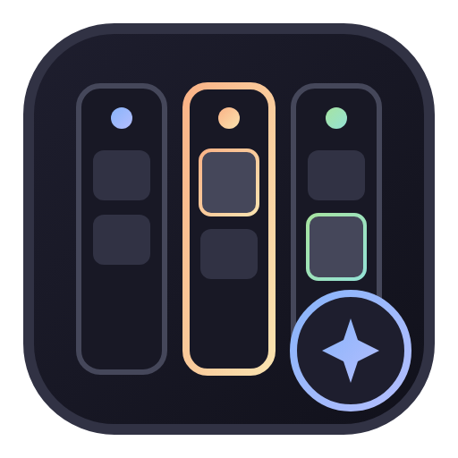

<p align="center">
  
</p>

# agy-github-worker

[](https://github.com/rrivera/agy-github-worker)
[](https://antigravity.google)

Core Antigravity plugin providing the autonomous `/github-worker` skill for agent-ready GitHub issue workflows.

---

## Overview

`agy-github-worker` is a fully autonomous issue worker engine built specifically for Antigravity:

- **Autonomous Issue Polling**: Scans target repositories for issues opted in via the `agent-ready` label.
- **Workflow State Management**: Manages state progression through labels (`status:todo`, `status:in-progress`, `status:waiting-on-user`, `status:in-review`, `status:done`).
- **Parallel Subagent Dispatch**: Spawns isolated `architect` subagents in dedicated git worktrees (`.worktrees/issue-<number>`), isolating builds and tests.
- **TDD Quality Gate**: Enforces Test-Driven Development (Red -> Green -> Refactor) and empirical verification before opening Pull Requests.
- **3-Axis Peer Code Review**: Automatically dispatches parallel read-only review subagents (`spec-reviewer`, `standards-reviewer`, `security-reviewer`) to evaluate changes against observable predicates.
- **Manual Merge Safety**: Keeps approved PRs in `status:in-review` for human approval by default, with per-conversation opt-in for automated squash-merging.

---

## Companion UI Board

Looking for the live Kanban auxiliary side pane? Install the standalone companion UI plugin:

👉 [**`rrivera/agy-github-worker-board`**](https://github.com/rrivera/agy-github-worker-board)

The companion board runs as an isolated sidecar webview in Antigravity's auxiliary side pane, providing real-time issue cards and GitHub navigation with zero AI token overhead.

---

## Directory Structure

```text
agy-github-worker/
├── plugin.json                              # Antigravity plugin manifest
├── README.md                                # Documentation & usage guide
├── assets/
│   ├── logo.svg                             # Vector logo
│   └── logo.png                             # Rendered PNG logo
└── skills/
    └── github-worker/
        ├── SKILL.md                         # Core skill entrypoint & state machine
        └── references/
            ├── architect-prompt.md          # Canonical architect subagent contract
            └── reviewer-prompts.md          # Canonical 3-axis reviewer contracts
```

---

## Installation in Antigravity

Clone the repository into your Antigravity plugins directory:

```bash
mkdir -p ~/.gemini/config/plugins
git clone https://github.com/rrivera/agy-github-worker ~/.gemini/config/plugins/agy-github-worker
```

Alternatively, you can install just the skill directory directly into your global skills:

```bash
mkdir -p ~/.gemini/config/skills
cp -r skills/github-worker ~/.gemini/config/skills/
```

Restart Antigravity. The `/github-worker` slash command will be available across all your workspaces.

---

## Usage

In any Antigravity conversation within a Git repository:

```text
/github-worker
```

To enable automatic merging for a specific session:

```text
/github-worker Pull the issues. Proceed to merge them and mark as done without my review.
```

---

## License

MIT
